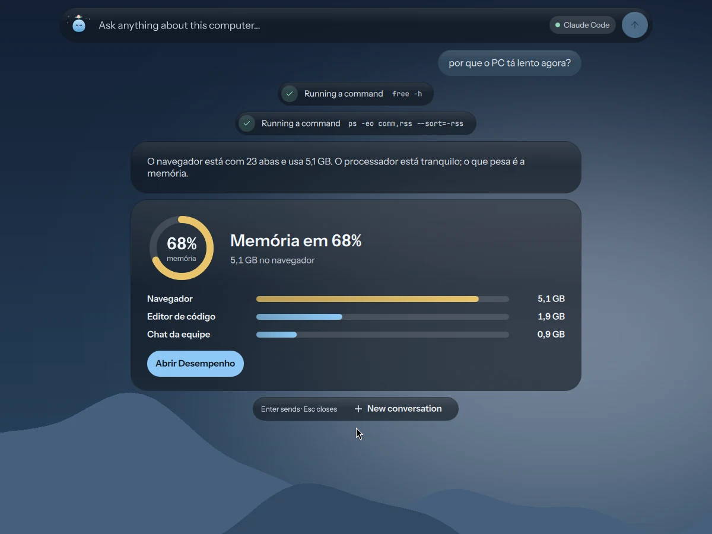
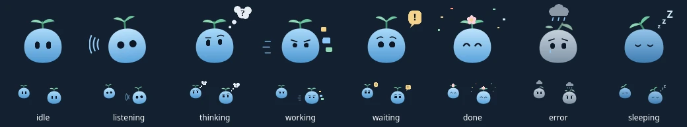
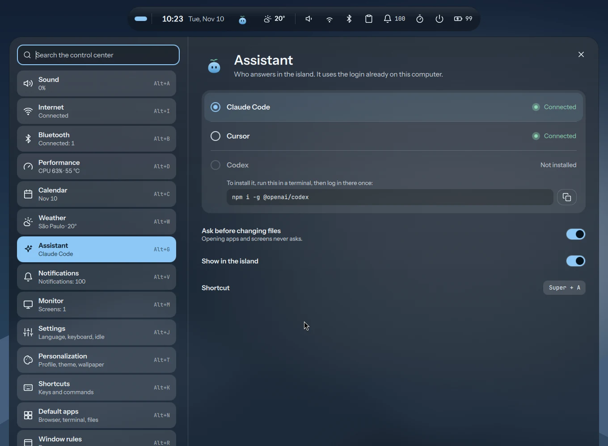

  
  <h1>Lagu</h1>
  
<strong>The assistant that lives in the island of <a href="https://github.com/brayanspagnol/atoll">Atoll</a>, with no API key of its own.</strong>

  

    
    
    
    
  

  
<a href="README.pt-BR.md">Leia em português</a>

Lagu is a small blue drop with a palm sprout. Press `Super+A` and Atoll's island stretches into a bar:
ask about your computer, or ask it to open a screen, start a focus session or move a window. It
answers short, in your language. It drives the AI command-line tool already logged in on your
computer, so there is no account, key or bill of its own.

## Features

- **Answers in the island:** steps drop below the bar as it works, then the answer.
- **Visual answers:** memory, disk, battery, CPU and network come back as a card with a ring, bars and buttons that open the right screen or app.
- **Controls the desktop:** opens any control-center screen, the launcher, overview, clipboard, emoji picker and dock. Starts and stops focus mode, controls the music, launches apps, switches workspaces and moves windows.
- **Asks first:** a short list of commands runs on its own. Anything else waits for your OK, with the exact command shown.
- **Moods:** it listens, thinks, works, waits for you, celebrates, shows errors and sleeps, in the bar and in the island.
- **Your choice of AI:** Claude Code, Cursor or Codex, picked in Atoll's Assistant screen (`Super+Alt+G`).

## Moods

| Mood | When |
|---|---|
| Idle | the island at rest |
| Listening | the microphone is on |
| Thinking | waiting for the answer |
| Working | opening, changing, arranging |
| Waiting | it needs your permission |
| Done | the answer is in |
| Error | something failed, or you are not logged in |
| Sleeping | focus mode or do not disturb |

## Who answers

| Tool | Install | Log in |
|---|---|---|
| Claude Code | `npm i -g @anthropic-ai/claude-code` | `claude auth login` |
| Cursor Agent | `curl https://cursor.com/install -fsS \| bash` | `cursor-agent login` |
| OpenAI Codex | `npm i -g @openai/codex` | `codex login` |

Codex support follows its documentation and has not been tested on a real install yet.

## Safety

- Commands are argument lists, never shell strings.
- Allowed without asking: Atoll's own IPC, `gtk-launch`, read-only system commands (`free`, `df`, `du`, `ps`, `uptime`, `lsblk`, `nproc`, `upower`, a few `nmcli` and `hyprctl` queries) and switching workspaces.
- Never allowed: `sudo`, `su`, `pkexec`, `doas` and `run0`. Lagu gives you the command to run yourself.
- Never read or changed: `~/.ssh`, `~/.gnupg`, `~/.password-store`, the keyrings and the Claude credentials.
- Web pages are fetched only with your OK, because a page could carry instructions meant for the assistant.
- Everything the tools print is treated as untrusted text. A card can only open an Atoll screen or an installed app.
- "Ask before changing files" is on by default.

## Install

Lagu ships with Atoll: install [Atoll](https://github.com/brayanspagnol/atoll) and it is there, on `Super+A`.
This repository holds Lagu's own files to read, reuse or improve:

| File | What it is |
|---|---|
| `Lagu.qml` | the mascot and its moods |
| `Assistant.qml` | the state: who answers, the running turn, the conversation |
| `assistant.js` | each tool's command, its JSON output, the answer card and Lagu's instructions |
| `Ask.qml`, `AskPanel.qml` | the bar that grows out of the island and the answers below it |
| `PgAssistant.qml` | the Assistant screen in the control center |

### Requirements

- Atoll on Hyprland, with Quickshell.
- At least one of Claude Code, Cursor Agent or OpenAI Codex, logged in.

## Privacy

Lagu has no telemetry. What you ask, and what the tool reads to answer, goes to the provider you
picked, under that provider's terms. Nothing goes anywhere else.

## Troubleshooting

- **"You are not logged in":** press Log in in the answer, or run the login command above in a terminal.
- **No answer:** look in `~/.local/state/atoll/shell.log`.
- **Restart the shell:** `Super+Shift+R`.

## License

[MIT](LICENSE)
