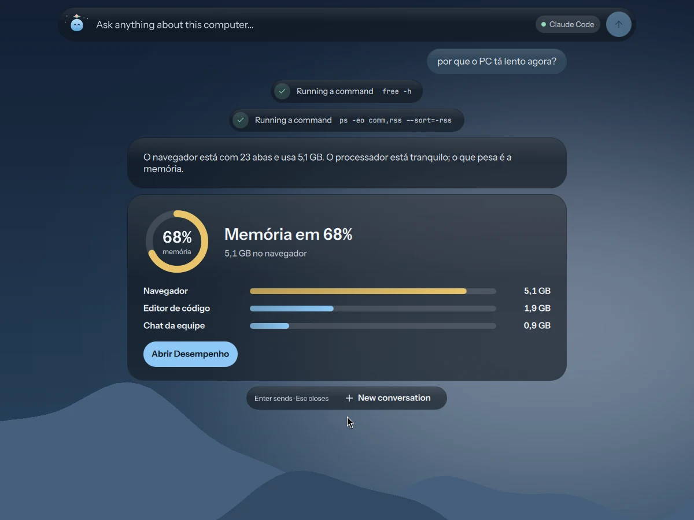
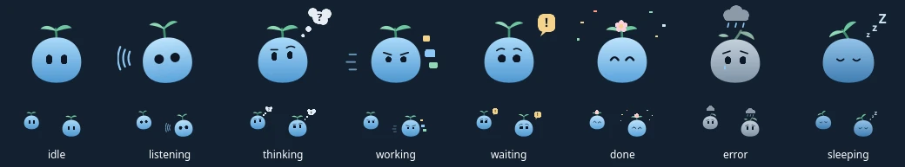
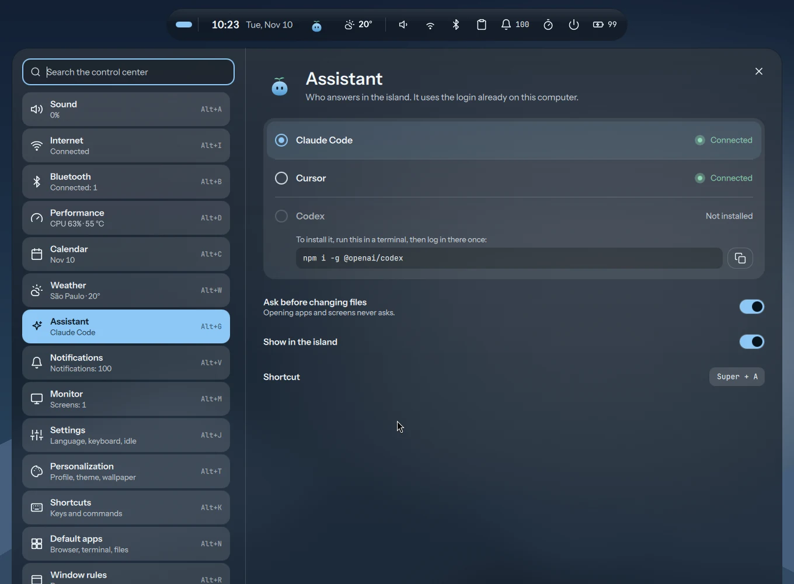

  
  <h1>Lagu</h1>
  
<strong>O assistente que mora na ilha do <a href="https://github.com/brayanspagnol/atoll">Atoll</a>, sem chave de API própria.</strong>

  

    
    
    
    
  

  
<a href="README.md">Read in English</a>

O Lagu é uma gotinha azul com um broto de palmeira. Aperte `Super+A` e a ilha do Atoll estica e vira
uma barra: pergunte sobre o seu computador, ou peça para abrir uma tela, começar um foco ou mover uma
janela. Ele responde curto, no seu idioma. Ele usa a ferramenta de IA de linha de comando que já está
logada no seu computador, então não tem conta, chave nem cobrança própria.

## Recursos

- **Responde na ilha:** os passos descem da barra enquanto ele trabalha, depois vem a resposta.
- **Respostas visuais:** memória, disco, bateria, processador e rede voltam como um card com anel, barras e botões que abrem a tela ou o app certo.
- **Controla o desktop:** abre qualquer tela da central, a busca, a visão geral, a área de transferência, os emojis e o dock. Liga e desliga o foco, controla a música, abre apps, troca de área de trabalho e move janelas.
- **Pergunta antes:** uma lista curta de comandos roda sozinha. O resto espera o seu OK, mostrando o comando exato.
- **Humores:** ele ouve, pensa, trabalha, espera por você, comemora, mostra erros e dorme, na barra e na ilha.
- **Você escolhe a IA:** Claude Code, Cursor ou Codex, na tela Assistente do Atoll (`Super+Alt+G`).

## Humores

| Humor | Quando |
|---|---|
| Parado | a ilha em repouso |
| Ouvindo | o microfone está ligado |
| Pensando | esperando a resposta |
| Fazendo | abrindo, mudando, organizando |
| Precisa de você | pedido de permissão |
| Feito | a resposta chegou |
| Deu errado | algo falhou, ou falta login |
| Dormindo | modo foco ou não perturbe |

## Quem responde

| Ferramenta | Instalar | Entrar |
|---|---|---|
| Claude Code | `npm i -g @anthropic-ai/claude-code` | `claude auth login` |
| Cursor Agent | `curl https://cursor.com/install -fsS \| bash` | `cursor-agent login` |
| OpenAI Codex | `npm i -g @openai/codex` | `codex login` |

O suporte ao Codex segue a documentação dele e ainda não foi testado numa instalação real.

## Segurança

- Comandos são listas de argumentos, nunca texto de shell.
- Sem perguntar: o IPC do próprio Atoll, `gtk-launch`, comandos de sistema só de leitura (`free`, `df`, `du`, `ps`, `uptime`, `lsblk`, `nproc`, `upower`, algumas consultas de `nmcli` e `hyprctl`) e trocar de área de trabalho.
- Nunca: `sudo`, `su`, `pkexec`, `doas` e `run0`. O Lagu te passa o comando para você rodar.
- Nunca lê nem muda: `~/.ssh`, `~/.gnupg`, `~/.password-store`, os chaveiros e as credenciais do Claude.
- Páginas da web só são abertas com o seu OK, porque uma página pode trazer instruções para o assistente.
- Tudo o que as ferramentas imprimem é tratado como texto não confiável. Um card só abre uma tela do Atoll ou um app instalado.
- "Perguntar antes de mudar arquivos" vem ligado.

## Instalação

O Lagu vem com o Atoll: instale o [Atoll](https://github.com/brayanspagnol/atoll) e ele já está lá, no `Super+A`.
Este repositório guarda os arquivos do Lagu para ler, reaproveitar ou melhorar:

| Arquivo | O que é |
|---|---|
| `Lagu.qml` | o mascote e os humores |
| `Assistant.qml` | o estado: quem responde, a vez em andamento, a conversa |
| `assistant.js` | o comando de cada ferramenta, a saída JSON, o card de resposta e as instruções do Lagu |
| `Ask.qml`, `AskPanel.qml` | a barra que sai da ilha e as respostas embaixo dela |
| `PgAssistant.qml` | a tela Assistente na central |

### Requisitos

- Atoll no Hyprland, com Quickshell.
- Pelo menos um entre Claude Code, Cursor Agent ou OpenAI Codex, com login feito.

## Privacidade

O Lagu não tem telemetria. O que você pergunta, e o que a ferramenta lê para responder, vai para o
provedor que você escolheu, nos termos dele. Nada vai para outro lugar.

## Problemas

- **"Você não está logado":** aperte Entrar na resposta, ou rode o comando de login acima num terminal.
- **Sem resposta:** veja `~/.local/state/atoll/shell.log`.
- **Reiniciar o shell:** `Super+Shift+R`.

## Licença

[MIT](LICENSE)
